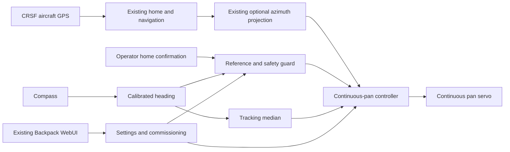

# Backpack AAT Continuous-Pan Architecture

Status: Draft. This document distinguishes the existing local prototype from the planned simplification; planned behavior is not yet implemented.

The goal is an optional continuous-rotation pan mode within the existing ExpressLRS Backpack antenna tracker, not a separate Pro product or hardware family. Preserve existing positional tracking, settings, CRSF telemetry, aircraft-GPS home acquisition, navigation, elevation, WebUI and firmware workflows. New functionality remains opt-in.

The [requirements](requirements.md) define the narrowed target scope, the [backlog](backlog.md) records current work and decisions, the [Backpack audit](backpack_audit.md) describes the original baseline, and [test history](backlog-history.md) retains bench evidence.

## Integration and hardware

Reuse the Backpack AAT module, PlatformIO target conventions, configuration storage, WebUI, telemetry routing and update mechanisms. Do not introduce a separate application, target registry, configuration system or manager framework.

The audited Backpack environments are `AAT_ESP_Backpack_via_UART`, `AAT_ESP_Backpack_via_WIFI` and `AAT_ESP32_Backpack_via_UART`. The local prototype adds `AAT_ESP32_Backpack_CompassPan`, extending the ESP32 UART environment with `AAT_COMPASS_TRACKING`, and a `CompassPan_Trace` variant for diagnostics. These are local changes, not an upstream release. The prototype uses an ESP32 DevKit with an HMC5883L-compatible compass on the existing I2C bus. Existing ESP8266 and other targets retain their behavior; the new option is available only where the actual build, pins and compass support it.

The prototype uses pan GPIO27, elevation GPIO14, compass/OLED SDA GPIO22 and SCL GPIO21. GPIO32 is an active-low operator button, not an automatic home or index sensor.

ESP32-S3, MAVLink input, tracker-local GPS, new prediction systems and other proposed Pro features are outside the active scope. Preserve Backpack's existing optional azimuth projection, including its legacy configuration.

## Tracking flow

The local continuous-pan implementation extends the existing AAT path:

The existing positional path remains separate. The local prototype uses Backpack's elevation endpoints and smoothing in mode 3; elevation updates only when the pan tracking command is valid and startup delay has elapsed, otherwise it holds its last commanded position.

## Pan mode and switching

**Current prototype:** Servo mode 3 selects continuous pan; modes 0-2 retain positional behavior. Selection is latched at boot, so changing modes currently requires a reboot. The continuous controller and servo are initialized according to the mode selected before boot. This is an implementation choice, not an inherent requirement of continuous rotation.

**Planned:** Permit switching without a reboot when safe, reusing the existing mode field where practical. Inhibit pan output and clear stale controller state on either transition; require explicit confirmation that the correct actuator is installed before enabling output. A continuous servo and a positional servo interpret the same pulse differently, so switching controllers must never inadvertently drive the wrong actuator. Entering continuous mode also requires valid calibration, reference, freshness and safety gates. Preserve legacy behavior for users who do not enable the option.

The Backpack Wi-Fi configuration and normal-operation lifecycle must be inspected separately: it may still require a reboot even if the controller can switch at runtime. Do not claim a completely reboot-free configuration workflow until verified. A software neutral request or detached output does not prove that the actuator physically stopped.

## Travel policies

**Current prototype:** The calibrated heading is converted to a signed home-relative pan. The target is clamped to +/-170 degrees, and the controller computes error within that bounded range. A target crossing the rear wrap can switch from +170 to -170 degrees, causing a long return through home rather than a short rear crossing. Measured pan outside the limit, invalid feedback or a greater-than-180-degree jump between successive home-relative positions invalidates the reference. These compass-based limits are not physical stops.

**Planned:** Keep that bounded policy as the default. Add an explicitly selected unrestricted policy only when the owner confirms the hardware can safely rotate indefinitely, for example with a slip ring or no winding cables. The unrestricted policy follows the shortest angular path, including a documented deterministic direction for an exact 180-degree tie. Its controller and guards must not apply bounded-only travel assumptions.

Changing policy must inhibit output and safely revalidate required setup. Both policies retain valid heading, reference, GPS freshness, neutral and output-envelope safeguards. A compass alone cannot count cable turns or detect a whole revolution missed between samples; unrestricted operation is unsafe on a setup with limited cable travel. The owner confirmed up to two turns in either direction for the current bench, not unlimited rotation.

## Commissioning and reference

The local prototype uses the existing Backpack WebUI and `/aatconfig` and `/aatservo` endpoints. Wi-Fi setup, a missing compass fit or invalid pulse calibration enters setup instead of GPS tracking. Setup is normally neutral, but an explicitly started guarded sweep, pulse calibration or manual direction check can drive the actuator.

The current commissioning sequence is:

1. **Compass fit:** Arm the owner sweep, hold GPIO32 through one turn and release at the mark. Stop cancels the sweep. The axis-aligned X/Y fit requires at least 36 samples, 10 of 12 sectors and return closure within 20 degrees; a field-magnitude ratio above 1.5 is a warning, not a rejection. These checks do not prove freedom from magnetic interference.
2. **Mounting response:** With servo power disconnected, compare a marked 90-degree clockwise hand turn to the calibrated heading. Reversed mounting can be corrected in the WebUI and must be checked again before north alignment. Reversal clears saved north alignment and invalidates pulse calibration. The initial positive-turn check is browser-enforced; reversed-mounting verification is persisted.
3. **True north:** Point the tracker north and save the heading offset. Changing the compass fit clears the saved north-aligned flag.
4. **Mechanical home:** With servo power disconnected, place the pan at its marked mechanical home and press and release GPIO32. North alignment and mechanical home are different references. Saved north alignment persists across boots, but home must be confirmed again; there is no timeout auto-zero. If north is not yet aligned, the startup path can capture both together.
5. **Minimum-motion pulse calibration:** After home confirmation and explicit powered approval, test left and right pulses in 5 us steps within owner-configured limits. The state machine uses fresh 500 ms heading windows, neutral-settling checks and directional displacement, and saves both start pulses only after settling at neutral. It is not a maximum-speed calibration. Timeout, wrong direction, travel, output and safety-gate failures cancel motion; the WebUI offers Stop / Neutral.

Preserve these protections unless a simpler approach is verified to be equivalent. Full same-image commissioning, stop/cancellation and persistence have not been established by the field evidence. Software-reported neutral is not proof of an electrical pulse or physical stop.

## Feedback, control and safety

In the current prototype, the compass is polled on a nominal 50 ms schedule. Tracking requires a valid calibrated heading, matching compass configuration, confirmed trigger/LOCK release and a sample no older than 500 ms. GPS requires the existing aircraft-GPS home and an update interval; freshness uses the three-interval rule with a hard age cap below 3 seconds. Tracking selects neutral unless alignment, reference, compass, GPS, pulse calibration and filter readiness gates pass. Reference loss requires a new operator confirmation at mechanical home. GPS loss blocks tracking and selects neutral, but the freshness timeout and loop timing mean it is not an immediate emergency stop.

Three distinct fresh home-relative compass samples feed a median for tracking only. The raw heading independently drives the safety guard and constrains the filtered command. A spike can therefore invalidate the reference even if the median would reject it; sustained outliers can pass the median. The cause and duration of observed spikes remain unknown.

The persisted deadband is 1-30 degrees, default 3. Outside it, the stateless proportional pulse profile starts at the calibrated directional pulse, tapers over the next 45 degrees and uses the existing `servoSmooth` setting to select 50-100% of the remaining pulse range. Neutral and directional maximum offsets define the 1000-2000 us envelope; prototype defaults are 1520 us neutral, 40 us left and 45 us right. Changing neutral or either limit invalidates minimum-motion calibration. This is not PID or a measured angular-speed limit; do not infer safe speed from a pulse offset.

The owner-accessible physical power cutoff remains the immediate response to unexpected motion. Powered tests require explicit owner approval and suitable hardware.

## Configuration and compatibility

Use the existing Backpack WebUI and versioned VRX configuration, rather than a separate interface or storage system. The local prototype exposes setup, calibration and readiness state, block reasons, pan target/error and requested/applied pulse readback. Active commissioning controls remain available for safety. Its mode 3 OLED uses the Backpack GPS display and compass pan marker after home confirmation; setup and reference prompts take precedence. OLED refresh is limited to 250 ms on the shared compass bus.

The local AAT configuration is v11: v6 added pan neutral, v7 compass fit, v8 north alignment, v9 deadband, v10 minimum-motion pulses and directional offsets, and v11 compass-mounting state. AAT migrations cover v5-v10; v9 migration invalidates pulse calibration and v10-to-v11 initializes standard mounting. Non-AAT VRX builds remain at v10. Unsupported versions reset to defaults. These are local changes, not an upstream release.

Future configuration changes must validate inputs and preserve legacy settings, including `project=0xff`, initializing only new fields. Native fixtures test migration helpers, not byte-accurate EEPROM layouts or every legacy field; serialized fixtures and current-version reload tests remain required. Add the planned travel policy and acknowledgment through existing Backpack mechanisms, with bounded operation as the default.

## Verification and source locations

The prototype reportedly passed 106 native tests and built the standard ESP32 AAT, CompassPan, CompassPan Trace and ServoTest targets. Earlier firmware passed directional tracking, a powered +170-degree clamp and a simulated 360-degree GPS orbit. OLED and elevation changes were flashed but not hardware-verified; a settled stop at the -170-degree clamp remains unverified. These results do not prove electrical PWM, exact stopping distance, maximum speed or immunity to compass spikes. The Trace build's 100 ms `PAN` records are sampled software telemetry, not every compass acquisition or a physical PWM measurement.

For the planned changes, verify legacy configuration migration and positional modes, transition inhibition and re-arming, stale/fault recovery, bounded clamp and rear wrap, unrestricted 359/1 wrap and deterministic 180-degree ties, and safe policy changes. Build existing AAT and relevant continuous-pan targets, and check WebUI/API and Wi-Fi behavior. Physical direction, neutral/fault handling and both policies require separately approved hardware tests.

The documented local implementation is in the separate Backpack firmware workspace, not this planning checkout:

| Responsibility | Backpack source |
| --- | --- |
| Runtime, GPS integration and Trace | `src/module_aat.cpp`, `src/module_crsf.cpp` |
| Heading, calibration and sensor driver | `src/aat_compass.h`, `src/aat_compass_calibration.h`, `src/aat_hmc5883l.h` |
| Reference, raw guard, tracking median and pulse profile | `src/aat_servo.h` |
| Minimum-motion calibration | `src/aat_pulse_calibration.h` |
| Configuration and validation | `lib/config/config.h`, `lib/config/config.cpp`, `include/aat_config_validation.h`, `include/aat_config_migration.h` |
| WebUI and API | `html/vrx_index.html`, `html/scan.js`, `src/devwifi_proxy_aat.cpp` |
| Targets and native tests | `targets/aat.ini`, `test/test_aat_navigation/test_navigation.cpp` |

Firmware inspection, implementation and verification require access to that source.
