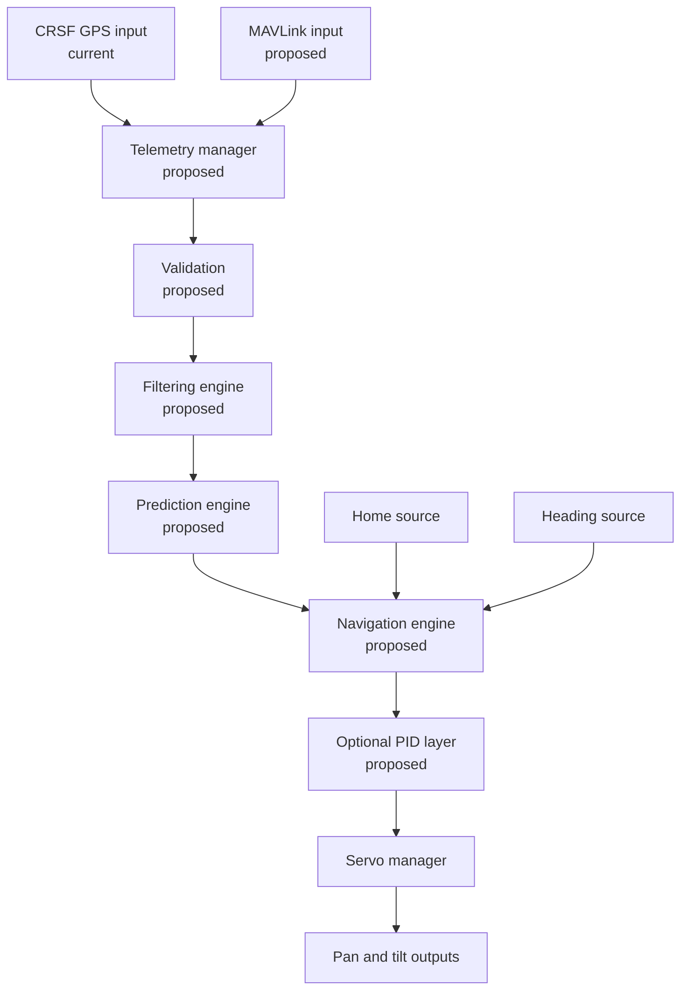

# Architecture
## AAT-Pro
### Advanced ExpressLRS Backpack Antenna Tracker

Version: 0.2 Draft

Status: Architecture Definition

Related Documents:

- requirements.md
- backpack_audit.md
- backlog.md

---

# 1. Executive Summary

AAT-Pro is an advanced antenna tracker target built on top of the existing ExpressLRS Backpack ecosystem.

The project extends the current AAT implementation while preserving compatibility with existing users and hardware.

This document describes the intended architecture, not the current firmware feature set. The verified Backpack implementation baseline is recorded in `backpack_audit.md`. Product variants and modules below are proposed unless the audit explicitly identifies them as current.

The primary objectives are:

- Reuse existing Backpack infrastructure
- Preserve AAT Classic behavior
- Support advanced ESP32 hardware
- Improve tracking quality
- Improve configuration experience
- Provide a scalable architecture for future development

AAT-Pro is not intended to replace AAT Classic.

It is intended to become an advanced member of the Backpack ecosystem.

---

# 2. Design Goals

## Primary Goals

- Zero regression for existing AAT users
- Native Backpack integration
- Upstream-friendly architecture
- Modular features
- Long-range FPV optimization
- ArduPilot compatibility

---

## Secondary Goals

- Modern WebUI
- GPS-aware home positioning
- Automatic orientation
- Continuous pan tracking
- Advanced diagnostics
- Future MAVLink support

---

# 3. Integration Philosophy

AAT-Pro shall be developed as an extension of the existing Backpack architecture.

The project shall reuse:

- Backpack build system
- Backpack WebUI infrastructure
- Backpack telemetry routing
- Backpack target registration
- ExpressLRS hardware target model
- Existing firmware update mechanisms

The project shall not introduce:

- Parallel configuration systems
- Independent firmware ecosystem
- Custom flashing workflows
- Independent target registry

Whenever an existing Backpack mechanism exists, it shall be reused.

---

# 4. Architecture Audit Findings

The checked-out Backpack implementation already provides infrastructure for:

- PlatformIO build environments and shared platform settings
- Target-specific compile flags, source selection, and pin definitions
- Firmware generation and upload environments
- Existing VRX configuration persistence
- Existing Backpack WebUI and telemetry processing

The current AAT environments are defined in `Backpack/targets/aat.ini` and included by the Backpack `platformio.ini`. They are:

```text
AAT_ESP_Backpack_via_UART
AAT_ESP_Backpack_via_WIFI
AAT_ESP32_Backpack_via_UART
```

The current AAT runtime consumes CRSF GPS frames, acquires home using a satellite-count threshold, and drives configured positional servos. See `backpack_audit.md` for the detailed baseline. No distinct ESP32-S3 AAT environment was found in `targets/aat.ini`.

New AAT-Pro builds shall extend these Backpack mechanisms rather than introduce a parallel target registry or build system. Exact target names, supported boards, and upload methods remain subject to the target definitions actually added to Backpack.

## Initial AAT-Pro Profile Decision

The initial AAT-Pro development profile is the existing `AAT_ESP32_Backpack_via_UART` environment on a generic ESP32 DevKit; no additional target registration is required for this profile. AAT Classic remains on the existing ESP8266 environment without changes. Initial position input is CRSF aircraft GPS only. Tracker-local GPS and compass drivers are excluded until specific modules, buses, and pins are selected. ESP32-S3 remains proposed and unverified.

---

# 5. Product Variants

The names and feature sets in this section are proposed product variants, not currently registered Backpack targets. The current build environment names are listed in Section 4. In particular, ESP32-S3 support must not be treated as available until a target definition and build validation exist.

## AAT_CLASSIC

Purpose:

```text
Legacy compatibility
```

Target Hardware:

```text
ESP8266
ESP8285
```

The audit verifies the ESP8266-class PlatformIO environment; exact ESP8285 hardware compatibility remains to be confirmed.

Features:

```text
Current AAT functionality
```

Behavior:

```text
Unchanged
```

---

## AAT_PRO_ESP32

Purpose:

```text
Enhanced tracking
```

Target Hardware:

```text
ESP32
```

Features:

```text
GPS
Compass
WebUI extensions
Pan 360
Filtering
```

---

## AAT_PRO_ESP32_S3

Purpose:

```text
Reference platform
```

Target Hardware:

```text
ESP32-S3
```

Features:

```text
All advanced features
```

including:

```text
Prediction
Diagnostics
Auto latency
Simulation
MAVLink
```

---

# 6. Target Definition Strategy

AAT-Pro shall extend the Backpack PlatformIO target/build definitions. A target addition should specify the platform, firmware selection, upload method, pin mapping, and compile-time feature availability using the existing project conventions.

Example proposed environment names:

```text
DIY_AAT_CLASSIC

DIY_AAT_PRO_ESP32

DIY_AAT_PRO_ESP32_S3
```

Each target shall define:

```text
Platform
Capabilities
Upload methods
Default pin mapping
Feature availability
```

These are examples only and are not current environment names.

---

# 7. Capability-Based Architecture

The firmware shall rely on capabilities rather than board names.

Preferred:

```cpp
if(capability.compass)
{
}
```

Not preferred:

```cpp
if(board == ESP32S3)
{
}
```

---

## Core Capabilities

```text
CAP_LOCAL_GPS

CAP_COMPASS

CAP_PAN360

CAP_OLED

CAP_WEBUI

CAP_PID

CAP_FILTERING

CAP_PREDICTION

CAP_AUTO_LATENCY

CAP_MAVLINK

CAP_DIAGNOSTICS

CAP_SIMULATION
```

---

# 8. Capability Activation Model

Hardware-dependent capabilities become active through:

```text
Build support
       +
Hardware present and valid
       +
User enabled
```

Software-only features require build support and user enablement; runtime hardware detection is not applicable to them. The current AAT implementation primarily uses compile-time macros and configuration fields; the capability model above is proposed and is not an existing Backpack abstraction.

Example:

```text
ESP32-S3 build

+
Compass detected

+
Compass enabled

=
Compass active
```

---

# 9. System Overview

The following is the proposed logical flow. CRSF GPS reception and positional servo output exist in the current AAT path; the other blocks and MAVLink input are proposed.



---

# 10. Core Modules

The modules below are proposed ownership boundaries and responsibilities. They do not imply that matching classes or interfaces currently exist in Backpack.

## TelemetryManager

Responsibilities:

```text
CRSF Reception
MAVLink Reception
Packet Validation
Packet Statistics
Telemetry Monitoring
```

Outputs:

```text
TargetState
```

---

## HomeManager

Responsibilities:

```text
Home Acquisition
Home Validation
Home Persistence
```

Sources:

```text
Manual
Telemetry
Local GPS
```

---

## HeadingManager

Responsibilities:

```text
Compass Reading
Heading Estimation
Calibration
```

Sources:

```text
Manual
Compass
Compass + GPS
```

## Pan Commissioning Lifecycle

The WebUI provides two distinct calibration operations:

- Owner commissioning uses a manual reference button to mark the start and return of one pan rotation, fits compass X/Y offsets and axis scales, and saves only after coverage validation.
- A later site sweep reuses the saved scale factors and updates only local X/Y offsets. A failed or incomplete sweep does not replace the saved fit.

The operator presses and holds the reference button before starting the sweep, releases it to begin rotation, and presses it again when the pan returns to the visual reference. The switch is not coupled to pan angle and does not detect servo neutral. Explicit cancellation, stale compass data, and a bounded timeout also stop the sweep. Neutral pulse and mechanical reference remain separate settings. Active tracking remains disabled in the commissioning build.

The local commissioning prototype is opt-in (`AAT_ESP32_Backpack_ServoTest`), not a complete production setup wizard. It uses single-shot HMC reads with a 500 ms retrigger, an axis-aligned min/max fit, and provisional 36-sample/10-of-12-sector acceptance. It reports field-magnitude spread but does not validate magnetic stability. Fitted-sector coverage does not independently prove a full turn. Saved calibration is not yet used for displayed raw heading/rate or tracking. Site refresh currently makes a full turn too; a genuinely shorter startup sweep remains future work.

Rework calibration UX and overall AAT consistency with existing Backpack options before release: ordered owner/site steps, explicit prerequisites, live/candidate/saved values, consistent save/apply behavior, cancellation/recovery, and desktop/mobile operation without an OLED.

---

## NavigationEngine

Responsibilities:

```text
Distance
Bearing
Elevation
```

Inputs:

```text
Home Position
Target Position
```

Outputs:

```text
Distance
Bearing
Elevation
```

---

## FilteringEngine

Responsibilities:

```text
GPS Filtering
EMA Filtering
Servo Deadband
Motion Smoothing
```

---

## PredictionEngine

Responsibilities:

```text
Velocity Estimation
Position Projection
Latency Compensation
Telemetry Loss Extrapolation
```

Modes:

```text
Off
Linear
Adaptive
```

---

## PIDController

Responsibilities:

```text
Pan Stabilization
Tilt Stabilization
Backlash Compensation
```

Two controllers:

```text
Pan PID

Tilt PID
```

---

## ServoManager

Responsibilities:

```text
Servo Abstraction
Rate Limiting
Acceleration Limiting
Tilt Easing
```

Supported Modes:

```text
Standard

Continuous 360-degree
```

---

## SafetyManager

Responsibilities:

```text
GPS Validation
Compass Validation
Telemetry Watchdog
Zenith Handling
Servo Monitoring
```

---

## DisplayManager

Responsibilities:

```text
OLED Rendering
Status Display
Field Diagnostics
```

Display remains optional.

---

## WebUiManager

Responsibilities:

```text
Configuration
Calibration
Diagnostics
Statistics
```

The WebUI is the primary configuration interface.

---

# 11. Position Sources

These are intended AAT-Pro sources. The current reviewed AAT path uses CRSF aircraft GPS; local tracker GPS and MAVLink aircraft input are not implemented in that path.

## Aircraft Position

Provided through:

```text
CRSF

or

MAVLink
```

Contains:

```text
Latitude
Longitude
Altitude
Speed
Heading
```

---

## Tracker Position

Provided through:

```text
Local GPS
```

Provides:

```text
Position
Satellite Count
HDOP
Fix Status
```

---

# 12. Tracking Modes

Standard Tracking describes the current baseline. The additional modes are proposed and depend on the hardware and source decisions recorded in `backlog.md`.

## Standard Tracking

Current AAT behavior.

Requirements:

```text
CRSF
2 Servos
```

---

## GPS-Aware Tracking

Adds:

```text
Local GPS
Automatic Home
```

---

## Compass Tracking

Adds:

```text
Absolute Heading
Automatic Orientation
```

---

## Continuous 360-Degree Tracking

Adds:

```text
Shortest Path Logic
Continuous Rotation
```

The positional-servo modes do not provide continuous-rotation pan feedback. The bench prototype selects SM-S4306R and rotating HMC5883L; production motion referencing, startup/recovery, and +/-170-degree travel protection remain unresolved. GPIO32 is an operator button, not an automatic home/index sensor. Up to two turns are permitted on the bench, not unlimited rotation.

---

## Predictive Tracking

Adds:

```text
Position Projection
Latency Compensation
```

---

# 13. WebUI Architecture

AAT-Pro shall extend the existing Backpack WebUI framework rather than introducing a separate implementation. The current AAT WebUI exposes existing configuration and live target overrides; the pages below are proposed extensions, not current pages.

---

## Status Page

Displays:

```text
GPS Status
Compass Status
Distance
Bearing
Elevation
Telemetry Status
```

---

## Configuration Page

Provides:

```text
Home Source
Telemetry Source
Heading Source
Pan Mode
```

---

## Servo Page

Provides:

```text
Limits
Direction
PID
Deadband
Motion Limits
```

---

## GPS Page

Displays:

```text
Tracker GPS
Aircraft GPS
Home Position
GPS Health
```

---

## Compass Page

Provides:

```text
Calibration
Heading
Health Status
```

---

## Prediction Page

Displays:

```text
Prediction Mode
Latency Estimate
Prediction Health
```

---

## Diagnostics Page

Displays:

```text
Telemetry Rate
Packet Loss
Servo Status
Prediction Error
System Health
```

---

# 14. Configuration Storage

Configuration extends Backpack's versioned VRX structure and EEPROM provider. The local prototype uses v7: v6 appended pan neutral; v7 appended fixed-point compass offsets, scales, mounting offset, and validity. Explicit v5/v6 migrations preserve existing fields and initialize new ones; unsupported versions still reset to defaults. These are local changes, not an upstream release.

DEC-05 compatibility policy remains: preserve existing values including `project=0xff`, initializing only new fields. Native fixtures test migration helpers, not byte-accurate EEPROM layouts or every legacy field. Serialized fixtures and current-version reload tests remain required before upstream contribution. The user verified HMC 104/32/1 and "Compass fit saved" after reboot; individual stored coefficients were not compared.

---

# 15. Safety Architecture

The thresholds and behaviors below are AAT-Pro requirements, not behavior verified in the current AAT implementation. The home source and the relationship between prediction grace time and telemetry-loss actions must be resolved before implementing the safety state machine.

## Home Validation

Requirements:

```text
3D Fix

Satellites >= 10

HDOP <= 1.5

Stable Position >= 30 seconds
```

---

## GPS Jump Rejection

Purpose:

```text
Reject invalid GPS spikes
```

---

## Compass Validation

Purpose:

```text
Reject invalid heading data
```

---

## Zenith Protection

Purpose:

```text
Avoid unstable bearing calculations
when the aircraft is overhead.
```

---

## Telemetry Watchdog

Timeout:

```text
3 seconds
```

Actions:

```text
Hold

Park

Return Home Direction
```

---

## Servo Fault Detection

Purpose:

```text
Detect blocked servos
or abnormal tracking behavior.
```

---

# 16. Performance Objectives

These are AAT-Pro targets, not measurements of the current implementation. `AatModule::Loop()` currently runs once per Arduino loop iteration without an active fixed schedule; servo writes are separately gated to at most one update per 10 milliseconds.

Tracking Loop:

```text
10 Hz minimum

20 Hz target
```

---

Servo Updates:

```text
50 Hz target
```

---

WebUI:

```text
Must never degrade
tracking performance.
```

### Proposed DEC-08 Acceptance (Pending Hardware Validation)

- Measure `AatModule::Loop()` start-to-start period and execution duration, plus actual servo-write intervals. Report minimum, p95, and maximum for each 60-second active-tracking capture.
- Hard limit: no tracking-loop gap over 100 milliseconds, preserving the 10 Hz minimum. Target: p95 loop period at or below 50 milliseconds, corresponding to 20 Hz.
- Servo target: p95 write interval at or below 20 milliseconds, corresponding to 50 Hz; no interval over 100 milliseconds.
- Report loop-period jitter as maximum minus minimum interval. Because the current loop is unpaced, treat this as descriptive; enforce the hard maximum-period limit rather than a separate jitter-range threshold.
- Compare matched active GPS/home captures with the WebUI idle and under 10 read-only `/config` requests per second. Both must meet the hard limits, and loaded p95 loop period and execution duration must increase by no more than 10% over idle.

These values are a proposal derived from the existing rate objectives. The current diagnostic reports min/max only; add percentile aggregation before using these p95 criteria. Ratify the limits only after matched captures on ESP8266 and ESP32 and investigation of the reported servo interval below the nominal 10 millisecond gate.

---

# 17. Backward Compatibility Rules

Rule 1

```text
Current AAT behavior and stored configuration remain unchanged unless the user explicitly enables a new AAT-Pro feature.
```

---

Rule 2

```text
AAT Classic remains supported.
```

---

Rule 3

```text
All AAT-Pro-only features are optional. Existing AAT behavior, including legacy configuration values such as the current nonzero projection setting, must be preserved during upgrade.
```

---

Rule 4

```text
Missing optional hardware
shall never prevent basic tracking.
```

Examples:

```text
No Compass
-> Manual Heading
```

```text
No GPS
-> Telemetry Home
```

```text
No OLED
-> WebUI Only
```

---

Rule 5

```text
Existing Backpack targets
shall not require modification.
```

---

# 18. Long-Term Vision

AAT-Pro aims to combine:

- Native ExpressLRS integration
- Existing Backpack ecosystem
- Continuous rotation tracking concepts
- Local GPS awareness
- Compass-based orientation
- Predictive tracking
- Automatic latency estimation
- Advanced diagnostics
- MAVLink support

while remaining fully aligned with Backpack architecture and retaining compatibility with existing AAT deployments.

---

# 19. Architectural Success Criteria

The architecture shall be considered successful when:

- AAT Classic remains unaffected.
- New targets integrate using Backpack infrastructure.
- No parallel configuration system exists.
- Most functionality is configurable through WebUI.
- Advanced hardware is optional.
- Features can be submitted upstream as independent pull requests.
- Features can be submitted upstream as independent pull requests.
- The system scales from ESP8266 AAT Classic to ESP32-S3 AAT-Pro Full.
 The system scales from ESP8266 AAT Classic to ESP32-S3 AAT-Pro Full.
