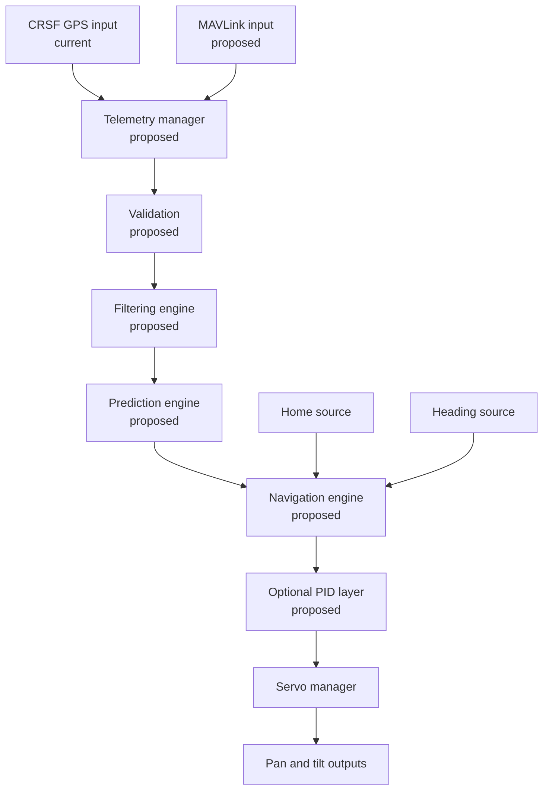
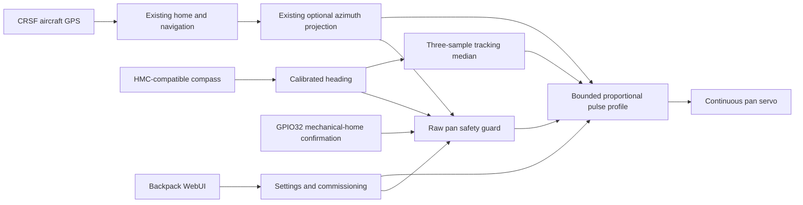

# Architecture
## AAT-Pro
### Advanced ExpressLRS Backpack Antenna Tracker

Version: 0.2 Draft

Status: Architecture Definition

Related Documents:

- requirements.md
- backpack_audit.md
- backlog.md

---

# 1. Executive Summary

AAT-Pro is an advanced antenna tracker target built on top of the existing ExpressLRS Backpack ecosystem.

The project extends the current AAT implementation while preserving compatibility with existing users and hardware.

This document combines the proposed architecture with the implemented continuous-pan prototype described in sections 9 and 10. Other product variants and logical modules remain proposals unless explicitly identified as implemented. The original Backpack baseline is recorded in `backpack_audit.md`; current work and evidence are in `backlog.md`.

The primary objectives are:

- Reuse existing Backpack infrastructure
- Preserve AAT Classic behavior
- Support advanced ESP32 hardware
- Improve tracking quality
- Improve configuration experience
- Provide a scalable architecture for future development

AAT-Pro is not intended to replace AAT Classic.

It is intended to become an advanced member of the Backpack ecosystem.

---

# 2. Design Goals

## Primary Goals

- Zero regression for existing AAT users
- Native Backpack integration
- Upstream-friendly architecture
- Modular features
- Long-range FPV optimization
- ArduPilot compatibility

---

## Secondary Goals

- Modern WebUI
- GPS-aware home positioning
- Automatic orientation
- Continuous pan tracking
- Advanced diagnostics
- Future MAVLink support

---

# 3. Integration Philosophy

AAT-Pro shall be developed as an extension of the existing Backpack architecture.

The project shall reuse:

- Backpack build system
- Backpack WebUI infrastructure
- Backpack telemetry routing
- Backpack target registration
- ExpressLRS hardware target model
- Existing firmware update mechanisms

The project shall not introduce:

- Parallel configuration systems
- Independent firmware ecosystem
- Custom flashing workflows
- Independent target registry

Whenever an existing Backpack mechanism exists, it shall be reused.

---

# 4. Architecture Audit Findings

The checked-out Backpack implementation already provides infrastructure for:

- PlatformIO build environments and shared platform settings
- Target-specific compile flags, source selection, and pin definitions
- Firmware generation and upload environments
- Existing VRX configuration persistence
- Existing Backpack WebUI and telemetry processing

The current AAT environments are defined in `Backpack/targets/aat.ini` and included by the Backpack `platformio.ini`. They are:

```text
AAT_ESP_Backpack_via_UART
AAT_ESP_Backpack_via_WIFI
AAT_ESP32_Backpack_via_UART
```

The original AAT runtime consumes CRSF GPS frames, acquires home using a satellite-count threshold, and drives configured positional servos. The local ESP32 prototype additionally provides the opt-in CompassPan environments described below. See `backpack_audit.md` for the original baseline. No distinct ESP32-S3 AAT environment was found in `targets/aat.ini`.

New AAT-Pro builds shall extend these Backpack mechanisms rather than introduce a parallel target registry or build system. Exact target names, supported boards, and upload methods remain subject to the target definitions actually added to Backpack.

## Initial AAT-Pro Profile Decision

The initial AAT-Pro development profile extends `AAT_ESP32_Backpack_via_UART` on a generic ESP32 DevKit. The local CompassPan profile uses an HMC5883L-compatible compass on the existing I2C bus. Initial position input is CRSF aircraft GPS only; tracker-local GPS is out of scope. ESP32-S3 remains proposed and unverified.

---

# 5. Product Variants

The names and feature sets in this section are proposed product variants, not currently registered Backpack targets. The current build environment names are listed in Section 4. In particular, ESP32-S3 support must not be treated as available until a target definition and build validation exist.

## AAT_CLASSIC

Purpose:

```text
Legacy compatibility
```

Target Hardware:

```text
ESP8266
ESP8285
```

The audit verifies the ESP8266-class PlatformIO environment; exact ESP8285 hardware compatibility remains to be confirmed.

Features:

```text
Current AAT functionality
```

Behavior:

```text
Unchanged
```

---

## AAT_PRO_ESP32

Purpose:

```text
Enhanced tracking
```

Target Hardware:

```text
ESP32
```

Features:

```text
GPS
Compass
WebUI extensions
Pan 360
Filtering
```

---

## AAT_PRO_ESP32_S3

Purpose:

```text
Reference platform
```

Target Hardware:

```text
ESP32-S3
```

Features:

```text
All advanced features
```

including:

```text
Prediction
Diagnostics
Auto latency
Simulation
MAVLink
```

---

# 6. Target Definition Strategy

AAT-Pro shall extend the Backpack PlatformIO target/build definitions. A target addition should specify the platform, firmware selection, upload method, pin mapping, and compile-time feature availability using the existing project conventions.

Example proposed environment names:

```text
DIY_AAT_CLASSIC

DIY_AAT_PRO_ESP32

DIY_AAT_PRO_ESP32_S3
```

Each target shall define:

```text
Platform
Capabilities
Upload methods
Default pin mapping
Feature availability
```

These are examples only and are not current environment names.

---

# 7. Capability-Based Architecture

The firmware shall rely on capabilities rather than board names.

Preferred:

```cpp
if(capability.compass)
{
}
```

Not preferred:

```cpp
if(board == ESP32S3)
{
}
```

---

## Core Capabilities

```text
CAP_LOCAL_GPS

CAP_COMPASS

CAP_PAN360

CAP_OLED

CAP_WEBUI

CAP_PID

CAP_FILTERING

CAP_PREDICTION

CAP_AUTO_LATENCY

CAP_MAVLINK

CAP_DIAGNOSTICS

CAP_SIMULATION
```

---

# 8. Capability Activation Model

Hardware-dependent capabilities become active through:

```text
Build support
       +
Hardware present and valid
       +
User enabled
```

Software-only features require build support and user enablement; runtime hardware detection is not applicable to them. The current AAT implementation primarily uses compile-time macros and configuration fields; the capability model above is proposed and is not an existing Backpack abstraction.

Example:

```text
ESP32-S3 build

+
Compass detected

+
Compass enabled

=
Compass active
```

---

# 9. System Overview

The following is a proposed general logical flow, not a diagram of the implemented CompassPan control loop. MAVLink and the named manager boundaries remain proposals.



## Implemented Continuous-Pan Flow

The local Backpack implementation uses the existing AAT module rather than the proposed manager classes:



The raw safety guard evaluates heading independently of the tracking median. It can invalidate the reference and select neutral before the median processes an outlier. The diagram does not imply a tracker-local GPS, turn counter, PID or independently verified electrical output.

---

# 10. Core Modules

The manager modules below are proposed ownership boundaries and do not imply matching Backpack classes. The continuous-pan prototype subsection documents the existing local implementation.

## TelemetryManager

Responsibilities:

```text
CRSF Reception
MAVLink Reception
Packet Validation
Packet Statistics
Telemetry Monitoring
```

Outputs:

```text
TargetState
```

---

## HomeManager

Responsibilities:

```text
Home Acquisition
Home Validation
Home Persistence
```

Conceptual sources, excluding the out-of-scope tracker-local GPS:

```text
Manual
Telemetry
```

---

## HeadingManager

Responsibilities:

```text
Compass Reading
Heading Estimation
Calibration
```

Sources:

```text
Manual
Compass
Compass + GPS
```

## Continuous-Pan Prototype

### Integration and activation

- `AAT_ESP32_Backpack_CompassPan` extends the existing ESP32 UART environment and enables `AAT_COMPASS_TRACKING`; `AAT_ESP32_Backpack_CompassPan_Trace` adds serial diagnostics. ServoTest remains a separate commissioning/diagnostic environment. These are local Backpack changes, not a claim of upstream release.
- Mode 3 selects continuous pan; modes 0-2 retain the positional path. Selection is boot-latched, so changing mode requires reboot. On supported hardware the pan servo is attached at the configured neutral. Wi-Fi setup, a missing fit or an invalid pulse calibration enters setup instead of GPS tracking. Setup is normally neutral but can drive the actuator during an explicitly started, guarded sweep, pulse calibration or manual direction check.
- The ESP32 target uses pan GPIO27, elevation GPIO14, and GPIO22/GPIO21 for the compass/OLED I2C bus. GPIO32 is an active-low operator button, not a home/index sensor.

The implementation lives in the sibling Backpack workspace:

| Responsibility | Local source |
| --- | --- |
| Runtime, GPS integration and Trace | `src/module_aat.cpp`, `src/module_crsf.cpp` |
| Heading, calibration and sensor driver | `src/aat_compass.h`, `src/aat_compass_calibration.h`, `src/aat_hmc5883l.h` |
| Reference, raw guard, tracking median and pulse profile | `src/aat_servo.h` |
| Automatic minimum-motion calibration | `src/aat_pulse_calibration.h` |
| Stored configuration and validation | `lib/config/config.h`, `lib/config/config.cpp`, `include/aat_config_validation.h`, `include/aat_config_migration.h` |
| WebUI and API | `html/vrx_index.html`, `html/scan.js`, `src/devwifi_proxy_aat.cpp` |
| Targets and native tests | `targets/aat.ini`, `test/test_aat_navigation/test_navigation.cpp` |

### Commissioning and reference

The Backpack WebUI presents continuous-pan neutral, left/right pulse offsets and deadband before the commissioning sequence:

1. **Compass fit:** arm the owner sweep, hold GPIO32 through one turn and release at the mark. Stop cancels the sweep. The axis-aligned X/Y fit requires at least 36 samples, 10 of 12 sectors and return closure within 20 degrees; a field-magnitude ratio above 1.5 is a warning, not a rejection. These checks do not prove freedom from magnetic interference.
2. **Mounting response:** with servo power disconnected, compare a marked 90-degree clockwise hand turn to the calibrated heading. The WebUI can apply a reversed-mounting correction and requires a repeat check before north alignment. Applying reversal clears saved north alignment and invalidates pulse calibration. The initial positive-turn check is browser-enforced; the reversed-mounting verification state is persisted.
3. **True north:** point the tracker north and save the heading offset once. A changed compass fit clears the saved north-aligned flag.
4. **Mechanical home:** with servo power disconnected, place the pan at its marked mechanical home and press/release GPIO32. North alignment and mechanical home are different references. On later boots the saved north offset remains, but home must be confirmed again; there is no timeout auto-zero. If north is not yet aligned, the startup path can capture north and home together.
5. **Minimum-motion pulse calibration:** after home confirmation and explicit powered approval, the state machine tests left and right pulses in 5 us steps within owner-configured limits. It uses fresh 500 ms heading windows, neutral-settling checks and directional displacement, then saves both start pulses only after settling at neutral. It is not an automatic maximum-speed calibration. Timeout, wrong direction, travel, output and safety-gate failures cancel motion; the WebUI offers Stop / Neutral.

Full same-image commissioning, stop/cancellation and persistence have not been established by the field evidence in [test history](backlog-history.md). A software-reported neutral is not proof of an electrical pulse or physical stop.

### GPS, heading and bounded motion

- CRSF GPS updates use the existing satellite-count-based aircraft-GPS home acquisition, navigation and optional azimuth projection. CompassPan does not add a tracker-local GPS or change the legacy home source.
- In mode 3, elevation uses Backpack's 0-90 degree positional mapping, configured endpoints and smoothing. It updates only when the pan tracking command is valid and startup delay has elapsed; otherwise it holds its last commanded position. The continuous-pan controller alone drives the pan output.
- The compass is polled on a nominal 50 ms schedule. Tracking requires a valid calibrated heading, matching compass configuration, confirmed trigger/LOCK release and a sample no older than 500 ms. A GPS fix requires an established GPS home and an update interval; freshness uses the existing three-interval rule with a hard age cap below 3 seconds.
- The safety controller converts calibrated heading to a signed home-relative pan. Measured pan outside +/-170 degrees, invalid feedback, or a greater-than-180-degree jump between successive home-relative positions invalidates the reference. The target is independently converted and clamped to +/-170 degrees. Error is the difference within that bounded coordinate range, rather than a command to cross the rear.
- When a moving GPS target crosses the rear wrap, the clamped target can switch from +170 to -170 degrees. The controller can therefore request a long return through home before tracking toward the other side. The limits are compass-based estimates, not physical stops; compass heading alone cannot count cable-winding turns or detect a whole revolution missed between samples.

### Tracking filter and pulse profile

- Three distinct, fresh home-relative compass samples feed a median used for tracking only. Output remains neutral until the median is ready; the filter resets on setup, invalid feedback or lost reference. A single isolated sample is suppressed when surrounded by valid samples, but sustained outliers can pass and filtering adds lag.
- The raw heading continues to drive the safety guard and raw-error constraint. A filtered pulse is suppressed if the raw error would not require motion in the same direction outside the deadband. A spike can therefore still invalidate reference, even if the tracking median would have rejected it. Improved spike handling is deferred to a later minor release.
- The persisted deadband is 1-30 degrees, default 3. Outside it, the stateless proportional profile starts at the calibrated directional pulse, tapers over the next 45 degrees and uses the existing `servoSmooth` setting to select 50-100% of the remaining pulse range. This is not PID or a measured degrees-per-second limit.
- Neutral and left/right maximum offsets define the pulse envelope within 1000-2000 us. Default neutral is 1520 us; default offsets are 40 us left and 45 us right, while owners can save other valid limits. Changing neutral or either limit invalidates the saved minimum-motion calibration. Never infer a safe angular speed from an offset alone.

### Safety, UI and diagnostics

Tracking selects neutral unless startup alignment, a valid reference, compass validity and GPS freshness are satisfied, the pulse calibration is valid, and the tracking median is ready. Reference loss requires a new operator confirmation at the marked mechanical home. GPS loss alone blocks tracking and selects neutral; stopping GPS replay is not an immediate emergency stop, because the freshness timeout and loop timing still apply.

The existing `/aatconfig` and `/aatservo` endpoints and Backpack WebUI expose setup actions, fit and mounting state, pulse calibration progress, reference/compass/GPS readiness, block reasons, pan target/error and requested/applied pulse readback. Mode-specific controls are shown for the selected pan mode; active setup controls remain available for safety. After home confirmation, mode 3 uses the Backpack GPS display, with compass heading for the pan marker; setup and reference prompts take precedence. OLED refresh is limited to 250 ms in mode 3 on the shared compass bus.

The Trace build adds 100 ms `PAN` records with raw compass axes, status, raw pan/error, `filter_ready`, `control_pan` and `control_error`. Trace is sampled software telemetry, not every compass acquisition or a physical PWM measurement. The owner-accessible physical power cutoff remains the immediate response to unexpected motion.

### Verification and limitations

The local changes passed 106 native tests and built the standard ESP32 AAT, CompassPan, CompassPan Trace and ServoTest targets. Earlier firmware passed hardware checks for directional tracking, a powered +170-degree clamp and a 360-degree simulated GPS orbit; in the orbit the target switched at the rear, trace reported a return through home, and the owner confirmed the antenna ended at home. The new OLED and elevation changes were flashed but their behavior has not been hardware-verified. An earlier counterclockwise sweep aborted after a compass spike caused reference loss; a powered settled stop at the -170-degree clamp is still unverified. These results do not establish electrical PWM, exact stopping distance, measured maximum speed or immunity to compass spikes. See [the backlog](backlog.md) and [test history](backlog-history.md) for current work and detailed evidence.

---

## NavigationEngine

Responsibilities:

```text
Distance
Bearing
Elevation
```

Inputs:

```text
Home Position
Target Position
```

Outputs:

```text
Distance
Bearing
Elevation
```

---

## FilteringEngine

Responsibilities:

```text
GPS Filtering
EMA Filtering
Servo Deadband
Motion Smoothing
```

---

## PredictionEngine

Responsibilities:

```text
Velocity Estimation
Position Projection
Latency Compensation
Telemetry Loss Extrapolation
```

Modes:

```text
Off
Linear
Adaptive
```

---

## PIDController

Responsibilities:

```text
Pan Stabilization
Tilt Stabilization
Backlash Compensation
```

Two controllers:

```text
Pan PID

Tilt PID
```

---

## ServoManager

Responsibilities:

```text
Servo Abstraction
Rate Limiting
Acceleration Limiting
Tilt Easing
```

Supported Modes:

```text
Standard

Continuous 360-degree
```

---

## SafetyManager

Responsibilities:

```text
GPS Validation
Compass Validation
Telemetry Watchdog
Zenith Handling
Servo Monitoring
```

---

## DisplayManager

Responsibilities:

```text
OLED Rendering
Status Display
Field Diagnostics
```

Display remains optional.

---

## WebUiManager

Responsibilities:

```text
Configuration
Calibration
Diagnostics
Statistics
```

The WebUI is the primary configuration interface.

---

# 11. Position Sources

The current AAT path uses CRSF aircraft GPS; MAVLink aircraft input is parked and tracker-local GPS is out of scope.

## Aircraft Position

Current input and parked alternative:

```text
CRSF (current)
MAVLink (parked)
```

Contains:

```text
Latitude
Longitude
Altitude
Speed
Heading
```

---

## Tracker Position

No tracker-local GPS position source or home-acquisition workflow is planned in the current scope.

---

# 12. Tracking Modes

Standard Tracking describes the legacy baseline. The local bounded continuous-pan prototype is implemented as described above; other additions below remain proposals, subject to the decisions in `backlog.md`.

## Standard Tracking

Current AAT behavior.

Requirements:

```text
CRSF
2 Servos
```

---

## GPS-Aware Tracking

Tracker-local GPS and local-GPS home acquisition are outside the current product scope.

---

## Compass Tracking

Adds:

```text
Absolute Heading
Automatic Orientation
```

---

## Bounded Continuous-Pan Tracking

The local mode 3 prototype uses a continuous-rotation servo and rotating HMC5883L-compatible compass. It tracks GPS bearings using home-relative +/-170-degree limits; it is not unrestricted 360-degree pan and does not count turns. A target crossing the rear wrap can require a long reversal through home rather than a short rear crossing. GPIO32 is an operator button, not an automatic home/index sensor. The owner verified up to two turns in either direction for the current bench, not unlimited rotation.

---

## Predictive Tracking

Adds:

```text
Position Projection
Latency Compensation
```

---

# 13. WebUI Architecture

AAT-Pro extends the existing Backpack WebUI framework rather than introducing a separate implementation. The local continuous-pan settings, commissioning controls and status use the existing WebUI and endpoints described in section 10; the pages below are proposed extensions, not a description of separate current pages.

---

## Status Page

Displays:

```text
GPS Status
Compass Status
Distance
Bearing
Elevation
Telemetry Status
```

---

## Configuration Page

Provides:

```text
Home Source
Telemetry Source
Heading Source
Pan Mode
```

---

## Servo Page

Provides:

```text
Limits
Direction
PID
Deadband
Motion Limits
```

---

## GPS Page

Any future GPS presentation must preserve the existing aircraft-GPS path; tracker-local GPS and its home workflow are out of scope.

---

## Compass Page

Provides:

```text
Calibration
Heading
Health Status
```

---

## Prediction Page

Displays:

```text
Prediction Mode
Latency Estimate
Prediction Health
```

---

## Diagnostics Page

Displays:

```text
Telemetry Rate
Packet Loss
Servo Status
Prediction Error
System Health
```

---

# 14. Configuration Storage

Configuration extends Backpack's versioned VRX structure and EEPROM provider. The local AAT prototype uses v11: v6 added pan neutral; v7 added fixed-point compass fit; v8 added north-alignment state; v9 added deadband; v10 added minimum-motion pulses and directional offsets; v11 added compass-mounting state. AAT migrations cover v5-v10 and initialize new fields; migration from v9 invalidates pulse calibration, and v10-to-v11 initializes standard mounting. Non-AAT VRX builds remain at v10. Unsupported versions reset to defaults. These are local changes, not an upstream release.

DEC-05 compatibility policy remains: preserve existing values including `project=0xff`, initializing only new fields. Native fixtures test migration helpers, not byte-accurate EEPROM layouts or every legacy field. Serialized fixtures and current-version reload tests remain required before upstream contribution. The user verified HMC 104/32/1 and "Compass fit saved" after reboot; individual stored coefficients were not compared.

---

# 15. Safety Architecture

CompassPan's implemented reference, compass, GPS-freshness and neutral-output gates are described in section 10. The broader behaviors below are proposed unless otherwise noted; they are not claims about the existing aircraft-GPS home path.

## Home Validation

Proposed criteria, not the current Backpack GPS-home policy:

```text
3D Fix

Satellites >= 10

HDOP <= 1.5

Stable Position >= 30 seconds
```

---

## GPS Jump Rejection

Proposed purpose; new GPS jump rejection is outside the current scope:

```text
Reject invalid GPS spikes
```

---

## Compass Validation

The local prototype validates compass freshness, configuration, trigger release and calibrated heading. It does not reject every plausible-looking heading spike; broader validation remains future work:

```text
Reject invalid heading data
```

---

## Zenith Protection

Purpose:

```text
Avoid unstable bearing calculations
when the aircraft is overhead.
```

---

## Telemetry Watchdog

The continuous-pan prototype selects neutral when GPS freshness fails, with a hard fix-age cap below 3 seconds. The following additional actions are proposed, not implemented by that gate:

```text
Hold

Park

Return Home Direction
```

---

## Servo Fault Detection

Purpose:

```text
Detect blocked servos
or abnormal tracking behavior.
```

---

# 16. Performance Objectives

These are AAT-Pro targets, not measurements of the current implementation. `AatModule::Loop()` currently runs once per Arduino loop iteration without an active fixed schedule; servo writes are separately gated to at most one update per 10 milliseconds.

Tracking Loop:

```text
10 Hz minimum

20 Hz target
```

---

Servo Updates:

```text
50 Hz target
```

---

WebUI:

```text
Must never degrade
tracking performance.
```

### Proposed DEC-08 Acceptance (Pending Hardware Validation)

- Measure `AatModule::Loop()` start-to-start period and execution duration, plus actual servo-write intervals. Report minimum, p95, and maximum for each 60-second active-tracking capture.
- Hard limit: no tracking-loop gap over 100 milliseconds, preserving the 10 Hz minimum. Target: p95 loop period at or below 50 milliseconds, corresponding to 20 Hz.
- Servo target: p95 write interval at or below 20 milliseconds, corresponding to 50 Hz; no interval over 100 milliseconds.
- Report loop-period jitter as maximum minus minimum interval. Because the current loop is unpaced, treat this as descriptive; enforce the hard maximum-period limit rather than a separate jitter-range threshold.
- Compare matched active GPS/home captures with the WebUI idle and under 10 read-only `/config` requests per second. Both must meet the hard limits, and loaded p95 loop period and execution duration must increase by no more than 10% over idle.

These values are a proposal derived from the existing rate objectives. The current diagnostic reports min/max only; add percentile aggregation before using these p95 criteria. Ratify the limits only after matched captures on ESP8266 and ESP32 and investigation of the reported servo interval below the nominal 10 millisecond gate.

---

# 17. Backward Compatibility Rules

Rule 1

```text
Current AAT behavior and stored configuration remain unchanged unless the user explicitly enables a new AAT-Pro feature.
```

---

Rule 2

```text
AAT Classic remains supported.
```

---

Rule 3

```text
All AAT-Pro-only features are optional. Existing AAT behavior, including legacy configuration values such as the current nonzero projection setting, must be preserved during upgrade.
```

---

Rule 4

```text
Missing optional hardware
shall never prevent basic tracking.
```

Examples:

```text
No Compass
-> Manual Heading
```

```text
No GPS
-> Telemetry Home
```

```text
No OLED
-> WebUI Only
```

---

Rule 5

```text
Existing Backpack targets
shall not require modification.
```

---

# 18. Long-Term Vision

AAT-Pro aims to combine:

- Native ExpressLRS integration
- Existing Backpack ecosystem
- Continuous rotation tracking concepts
- Local GPS awareness
- Compass-based orientation
- Predictive tracking
- Automatic latency estimation
- Advanced diagnostics
- MAVLink support

while remaining fully aligned with Backpack architecture and retaining compatibility with existing AAT deployments.

---

# 19. Architectural Success Criteria

The architecture shall be considered successful when:

- AAT Classic remains unaffected.
- New targets integrate using Backpack infrastructure.
- No parallel configuration system exists.
- Most functionality is configurable through WebUI.
- Advanced hardware is optional.
- Features can be submitted upstream as independent pull requests.
- Features can be submitted upstream as independent pull requests.
- The system scales from ESP8266 AAT Classic to ESP32-S3 AAT-Pro Full.
 The system scales from ESP8266 AAT Classic to ESP32-S3 AAT-Pro Full.
